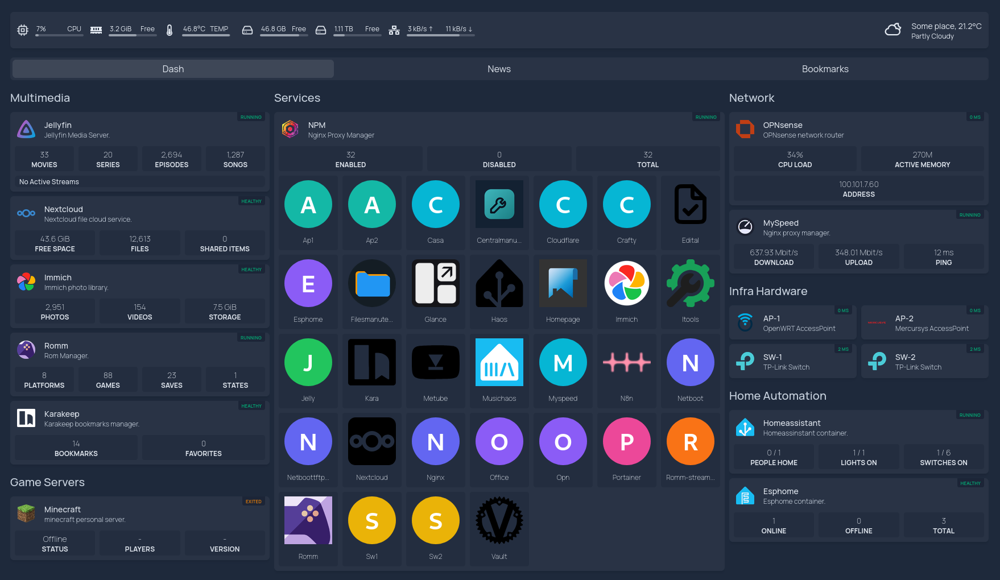
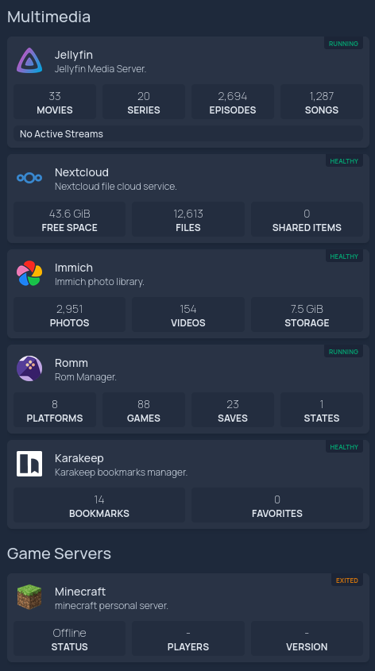
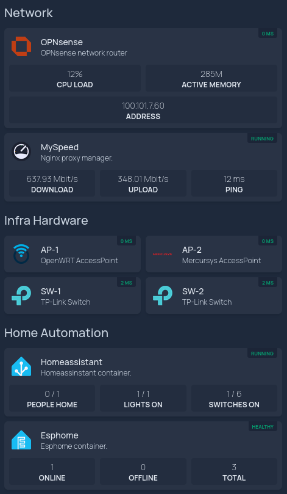
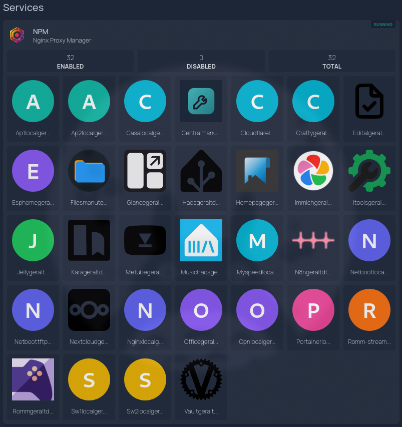
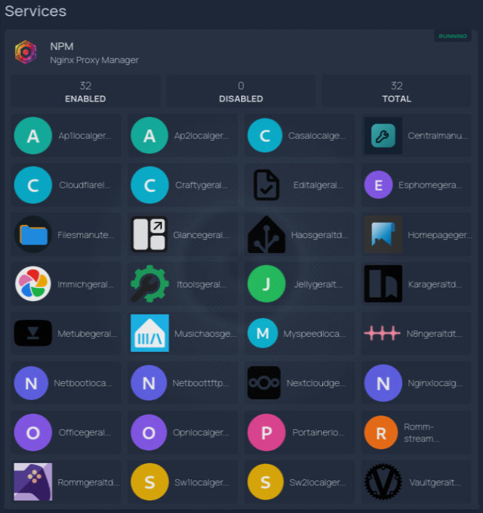
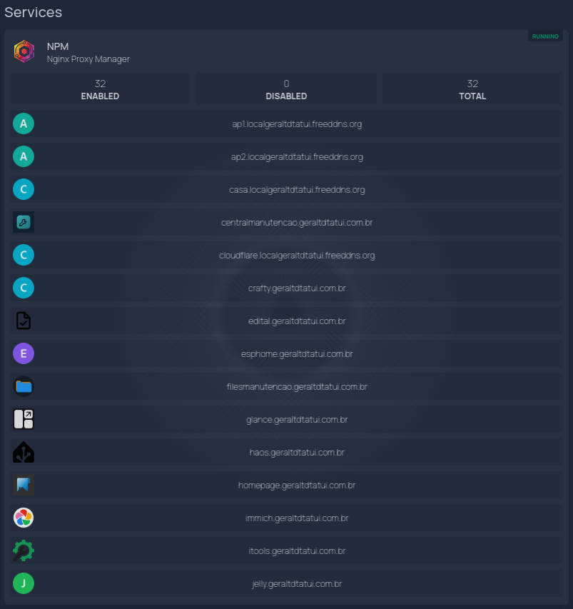
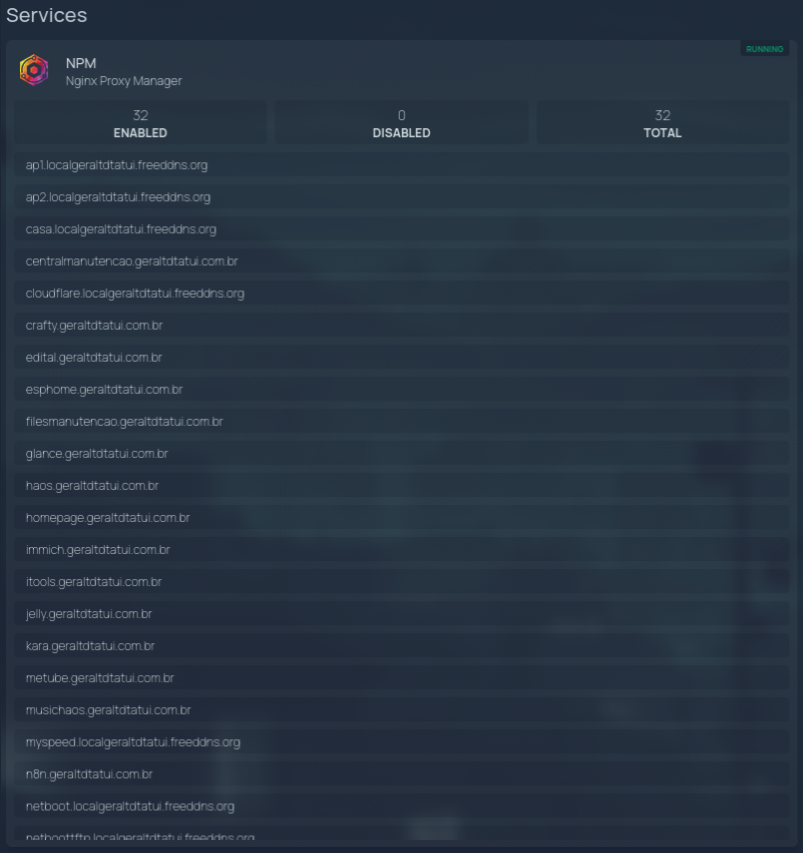
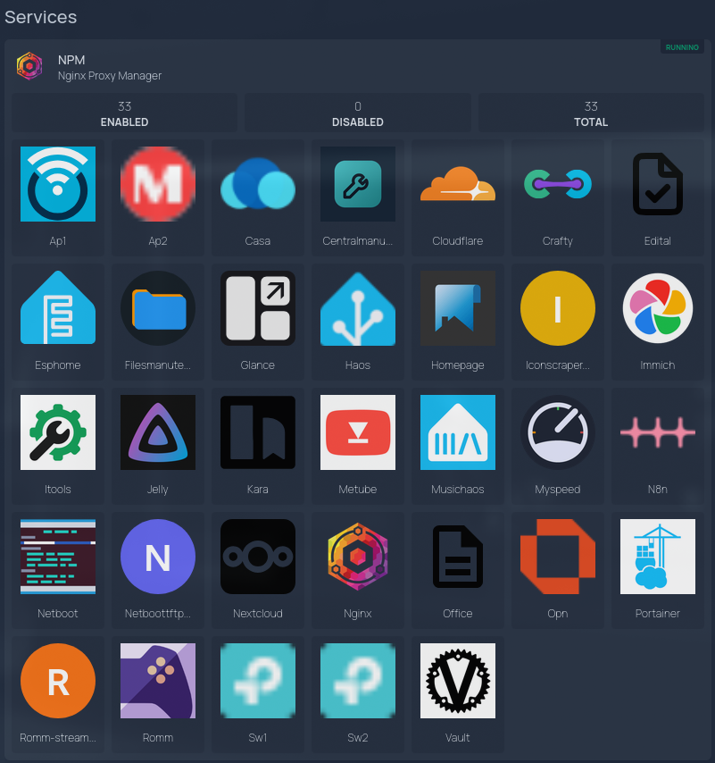

# Custom Homepage Configuration

> **Official documentation:** all configurations in this repository are based on the Homepage documentation. If you have questions about options, parameters, widgets, installation, or application behavior, always consult the [official Homepage documentation](https://gethomepage.dev/) before making changes. The documentation is the primary reference and may be updated independently of this repository.

This repository contains my custom [Homepage](https://gethomepage.dev/) configuration, a dashboard for centralizing access to services and monitoring infrastructure resources.

In addition to organizing services, the project includes a customization of the integration with **Nginx Proxy Manager (NPM)**: Proxy Hosts are retrieved through the Nginx API and displayed in a grid, with website icons whenever available.

> **Important:** this repository contains configuration and customization files. It does not include the `.env` file, tokens, passwords, or other credentials. Configure the required values in the environment where Homepage will run.

## Screenshots

### Dashboard overview "Grid" (Customization option using custom.css and custom.js)
This is my idea of how a dashboard should work, presenting an interface very similar to those offered by the [CasaOS](https://casaos.zimaspace.com/) and [ZimaOS](https://www.zimaspace.com/) projects, while adding a grid-style list to display all the services I host using [Nginx Proxy Manager](https://nginxproxymanager.com/).



### Widgets and server information
I chose to display two sections on the sides, listing all the services I use, their statistics, and the network devices in my infrastructure.

| Multimedia section | Network section |
|---|---|
|  |  |

### News feed using RSS
I separated the infrastructure dashboard and my news feed into tabs. In the news feed, I added Brazilian tech news websites.


## Features

- Organization of services into groups and tabs.
- Widgets for Jellyfin, Nextcloud, Immich, RomM, Karakeep, Minecraft, OPNsense, Tailscale, MySpeed, Home Assistant, and ESPHome.
- Integration with Nginx Proxy Manager to retrieve Proxy Hosts through its API.
- Display of Proxy Hosts in a grid, with simplified names and the corresponding website icons.
- Fallback icon for hosts whose icon cannot be found or loaded.
- Weather and server resource monitoring widgets.
- Environment variables to keep addresses and credentials separate from version-controlled files.

## File structure

The files should be placed in the Homepage configuration directory, alongside the `custom.css` and `custom.js` files:

```text
config/
├── bookmarks.yaml
├── docker.yaml
├── kubernetes.yaml
├── proxmox.yaml
├── services.yaml
├── settings.yaml
├── widgets.yaml
├── custom.css
└── custom.js
```

| File | Purpose |
|---|---|
| `bookmarks.yaml` | Links grouped by category. |
| `docker.yaml` | Connection to Docker through the local socket. |
| `kubernetes.yaml` | File reserved for Kubernetes configuration. |
| `proxmox.yaml` | Commented example of Proxmox configuration. |
| `services.yaml` | Services, groups, links, and widgets, including Nginx Proxy Manager. |
| `settings.yaml` | Tabs, layout, headers, and search options. |
| `widgets.yaml` | Global weather and system resource widgets. |
| `custom.css` | Grid layout and visual adjustments for the Proxy Hosts section. |
| `custom.js` | List observation, name handling, and icon loading. |

To learn about the purpose, available options, and accepted formats for configuration files, consult the [official Homepage configuration documentation](https://gethomepage.dev/configs/). There are also specific references for [bookmarks](https://gethomepage.dev/configs/bookmarks/), [Docker](https://gethomepage.dev/configs/docker/), [Kubernetes](https://gethomepage.dev/configs/kubernetes/), [Proxmox](https://gethomepage.dev/configs/proxmox/), [services](https://gethomepage.dev/configs/services/), [settings](https://gethomepage.dev/configs/settings/), and [global widgets](https://gethomepage.dev/configs/info-widgets/).

## Installation

1. Run Homepage and identify the host directory mounted as the container's configuration directory.
2. Donwload this repo source code, or git clone it to your Homepage's host server.
3. Copy this repo source code YAML files, `custom.css`, and `custom.js` into that directory.
    1. Depending what you want to achieve, not all files would need to be copied.
    2. For example, to preview host in a ordered list, you don't need to copy `custom.css`, neither `custom.js`.
4. Configure the environment variables used by the files, as described in the [Environment variables](#environment-variables) section.
5. Configure access to the Nginx Proxy Manager API and generate a token, as described in the [Nginx Proxy Manager integration](#nginx-proxy-manager-integration) section.
6. Restart Homepage or wait for the configurations to load, then check the dashboard.

The Docker connection uses `/var/run/docker.sock`. Therefore, for the container widgets to work, this socket must be available to Homepage in the environment where it runs.

## Nginx Proxy Manager integration

The integration uses two widgets associated with the Nginx Proxy Manager service in `services.yaml`:

- The native `npm` widget, which retrieves information from Nginx Proxy Manager.
- The `customapi` widget, which queries the Proxy Hosts endpoint and provides the list displayed on the dashboard.

The `customapi` uses the following endpoint:

```text
http://<HOMEPAGE_VAR_SERVER_IP>:81/api/nginx/proxy-hosts
```

The request sends the token in the HTTP `Authorization` header:

```http
Authorization: Bearer <HOMEPAGE_VAR_NGINX_TOKEN>
```

The `customapi` configuration uses `display: dynamic-list`, retrieves the first domain from `domain_names` (`domain_names.0`), and uses that domain as the link destination. The custom JavaScript and CSS change how this list is displayed.

### The token must be configured separately

**The Custom API widget does not automatically reuse the token configured in the native Nginx Proxy Manager widget.** Even if the native `npm` widget is authenticated, the `customapi` must receive the token explicitly in the `Authorization` header.

Therefore, configure `HOMEPAGE_VAR_NGINX_TOKEN` in the Homepage environment. This same variable is referenced in the `customapi` header in the files in this repository.

### 1. Generate a token through the Nginx Proxy Manager API

With the Nginx Proxy Manager API accessible, run the command below. Replace the address, port, username, and password with the values for your installation:

```bash
curl -X POST "http://<nginx-address>:PORT/api/tokens" \
  -H "Content-Type: application/json" \
  -d '{"identity":"your@email.com","secret":"yourPassword"}'
```

The API response contains the token. Use the returned value to configure `HOMEPAGE_VAR_NGINX_TOKEN` in the Homepage environment.

### 2. Extend the token expiration

To request that the token's validity be extended to 10 years, run:

```bash
curl -X GET 'http://<nginx-address>:PORT/api/tokens?expiry=10y' \
  -H 'Authorization: Bearer YOUR_TOKEN_HERE' \
  -H 'Accept: application/json'
```

Replace `YOUR_TOKEN_HERE` with the token obtained in the previous step.

> **Security:** a token with an extended validity period must be treated like a password. Do not share it with anyone!

## How the Proxy Hosts list is customized

The API integration provides the list items. The grid layout and icons are implemented by the project's customization layer through `custom.js` and `custom.css`.

### JavaScript (`custom.js`)

The script:

1. Observes document changes using `MutationObserver` and monitors the section defined in `nginx_section_id`.
2. Waits for the Proxy Hosts list to load and applies the changes after a short period with no new changes (`debounce_timeout`, defined in the script itself).
3. Can simplify the name displayed for each host by using the subdomain and removing the suffixes configured in `domain_name_filter`.
4. In the `grid` and `compact-list` layouts, when the name has 11 characters or more, keeps the first 11 and adds `...`.
5. When enabled, requests an icon for each address using the service configured in `icon_scraper_api`.
6. Uses a fallback SVG icon when the image cannot be loaded.
7. Can increase the width of the Proxy Hosts section and organize the items in the `list`, `grid`, or `compact-list` layouts.

#### Configuration options

The options are located in the `configurations` object at the beginning of the `custom.js` file:

| Option | Purpose |
|---|---|
| `load_customizations` | Enables or disables all script customizations. |
| `nginx_section_id` | ID of the Homepage section that will receive the customizations. Must match the ID configured in the YAML. |
| `subdomains_as_name` | Uses the subdomain as the Proxy Host name in the `grid` and `compact-list` layouts. |
| `domain_name_filter` | List of domain suffixes removed when building the name. If the list is empty, the script considers only the part before the first dot. |
| `fetch_domain_icons` | Enables or disables the inclusion of domain icons. |
| `icon_scraper_api` | Base address of the service used to fetch icons. |
| `larger_nginx_section` | Applies a CSS class to make the Proxy Hosts section larger than the others. |
| `proxy_host_layout` | Defines how items are displayed: `list`, `grid`, or `compact-list`. |
| `icon_size` | Defines the size of icons in the `list` and `compact-list` layouts. Accepts CSS units such as `px` and `em`. |

### Grid Layout Exemple


#### Code:
```javascript
const configurations = {
    load_customizations: true,
    
    nginx_section_id: "services",
    subdomains_as_name: true,
    domain_name_filter: [        
        "example.com",
        "internal.example.net",
    ],

    fetch_domain_icons: true,
    icon_scraper_api: "https://geticon.dev/?url=",
    
    larger_nginx_section: true,
    proxy_host_layout: "grid",
    icon_size: "30px",
}
```

### Compact List Layout Exemple


#### Code:
```javascript
const configurations = {
    load_customizations: true,
    
    nginx_section_id: "services",
    subdomains_as_name: true,
    domain_name_filter: [        
        "example.com",
        "internal.example.net",
    ],

    fetch_domain_icons: true,
    icon_scraper_api: "https://geticon.dev/?url=",
    
    larger_nginx_section: true,
    proxy_host_layout: "compact-list",
    icon_size: "50px",
}
```

### List Layout Exemple


#### Code:
```javascript
const configurations = {
    load_customizations: true,
    
    nginx_section_id: "services",
    subdomains_as_name: false,
    domain_name_filter: [        
        "example.com",
        "internal.example.net",
    ],

    fetch_domain_icons: true,
    icon_scraper_api: "https://geticon.dev/?url=",
    
    larger_nginx_section: true,
    proxy_host_layout: "list",
    icon_size: "30px",
}
```

### List without icons nither sudomain to name convertion Layout Exemple


#### Code:
```javascript
const configurations = {
    load_customizations: true,
    
    nginx_section_id: "services",
    subdomains_as_name: false,
    domain_name_filter: [        
        "example.com",
        "internal.example.net",
    ],

    fetch_domain_icons: false,
    icon_scraper_api: "https://geticon.dev/?url=",
    
    larger_nginx_section: true,
    proxy_host_layout: "list",
    icon_size: "30px",
}
```

The default address configured for retrieving icons is `https://geticon.dev`. This address can be changed in `icon_scraper_api` to use another compatible service. To disable icon loading, set `fetch_domain_icons: false`.

### Fetching icons with a custom icon scraper API
To simplify icon retrieval, I developed a dedicated **[Icon Scraper API](https://github.com/GERALTdTATUI/Icon_Scraper)**, which runs locally in Docker and provides a centralized way to retrieve website icons. Homepage custom.js can use this API to automatically find and retrieve icons from websites, making the process of managing and displaying service icons easier and more consistent and being able to fetch icons while offline across the dashboard.

The API works by fetching the pages through your nginx proxy hosts list, when a page is fetched the API looks for dafault html icon elements (like <link rel="icon" href="...">) and redirected the client to the icon href target. When no icons were found the API tries some common icon locations (like ${domain}/favicon.svg) and redirect the client to anything it could thing and if no guesses were correct the API relays the requested domain to some external APIs in order to, at least, return some placehoalder.

The custom API can be configured to not use external APIs, drop the request if the host is downs and skip the path guessing, all configured through url params. More can be seem on [my git repo](https://github.com/GERALTdTATUI/Icon_Scraper)

#### Example of the custom API scraped icons:
| Scraped with geticon.dev api | Scraped with the custom api |
|---|---|
|  |  |

The local scraping API was able to fetch some icons that the external API.

### CSS (`custom.css`)

The CSS:

- Adjusts the minimum width of the `#services` section at different screen widths.
- In grid layouts, turns the Proxy Hosts list into a responsive grid with columns at least 100 px wide.
- Arranges each item vertically to accommodate the icon and host name.
- Adjusts image sizes and item spacing.

The CSS and JavaScript selectors depend on the HTML structure generated by Homepage, including selectors such as `#services > div > div:nth-child(3) > div`. Changes to Homepage's internal structure or layout may require adjustments to these selectors.

For questions about native CSS and JavaScript customization features, consult the [Custom CSS & JS section of the official documentation](https://gethomepage.dev/configs/custom-css-js/). To understand the service configuration and the structure of the widgets used as the source of the list, also consult [Services](https://gethomepage.dev/configs/services/) and the [widget reference](https://gethomepage.dev/widgets/).

## Environment variables

The files use `HOMEPAGE_VAR_*` variables to avoid placing addresses, identifiers, and credentials directly in the YAML files. Configure them in the Homepage environment;

| Variable | Usage in the project |
|---|---|
| `HOMEPAGE_VAR_DOMAIN` | Base domain used in service addresses. |
| `HOMEPAGE_VAR_SERVER_IP` | Server address used by the Nginx `customapi` and the ESPHome widget. |
| `HOMEPAGE_VAR_NGINX_TOKEN` | Nginx Proxy Manager API token, used by the `npm` and `customapi` widgets. |
| `HOMEPAGE_VAR_JELLYFIN_KEY` | Jellyfin API key. |
| `HOMEPAGE_VAR_NEXTCLOUD_KEY` | Nextcloud API key. |
| `HOMEPAGE_VAR_IMMICH_KEY` | Immich API key. |
| `HOMEPAGE_VAR_KARAKEEP_KEY` | Karakeep API key. |
| `HOMEPAGE_VAR_ROUTER_IP` | OPNsense address used by the widget and availability monitoring. |
| `HOMEPAGE_VAR_OPN_USER` | OPNsense username. |
| `HOMEPAGE_VAR_OPN_PASS` | OPNsense password. |
| `HOMEPAGE_VAR_TAILSCALE_KEY` | Tailscale API key. |
| `HOMEPAGE_VAR_TAILSCALE_DEV_ID` | Device identifier used by the Tailscale widget. |
| `HOMEPAGE_VAR_HOMEASSISTANT_KEY` | Home Assistant API key. |
| `HOMEPAGE_VAR_NET_DEV_1` to `HOMEPAGE_VAR_NET_DEV_4` | Addresses of the access points and switches monitored by ping. |
| `HOMEPAGE_VAR_ESPHOME_USER` | ESPHome username. |
| `HOMEPAGE_VAR_ESPHOME_PASS` | ESPHome password. |
| `HOMEPAGE_VAR_LOCATION_NAME` | Name displayed in the Open-Meteo widget. |
| `HOMEPAGE_VAR_LATITUDE` | Latitude used by Open-Meteo. |
| `HOMEPAGE_VAR_LONGITUDE` | Longitude used by Open-Meteo. |
| `HOMEPAGE_VAR_DISKS` | Disks monitored by the resource widget. |

To learn how Homepage interprets environment variables in configuration files, consult the [Using Environment Secrets section of the official documentation](https://gethomepage.dev/installation/docker/#using-environment-secrets). It explains the use of the `HOMEPAGE_VAR_` and `HOMEPAGE_FILE_` prefixes and how values are substituted in files.

## Notes and privacy

- Container names, ports, and example internal addresses **may need to be adapted to your network** and installation.
- The external icon service receives the Proxy Host address as a query parameter. When using `geticon.dev`, keep in mind that the domains submitted for icon retrieval will be shared with this service. To avoid this, configure your own service or another icon retrieval method.
- `custom.js` and `custom.css` depend on Homepage's visual structure and may require maintenance after project updates.

## Credits

- [Homepage](https://gethomepage.dev/) — dashboard and widget system.
- [Nginx Proxy Manager](https://nginxproxymanager.com/) — Proxy Hosts management and the API used by the integration.
- [geticon.dev](https://geticon.dev/) — service configured by default to retrieve website icons.
