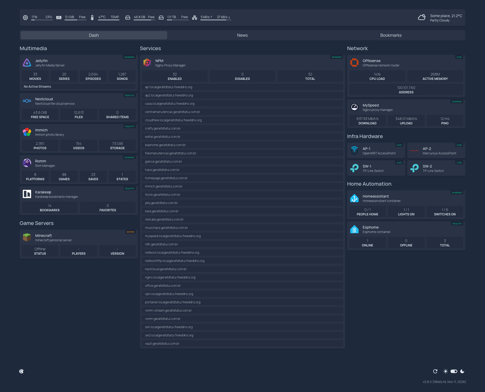
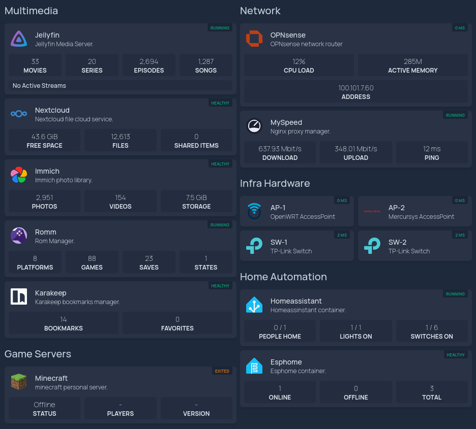
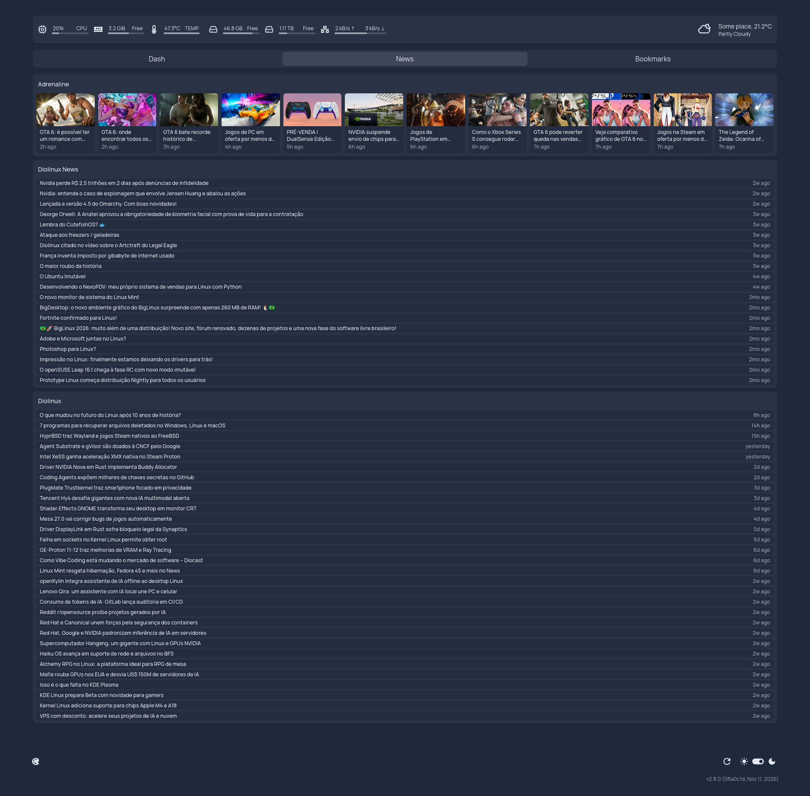

# Custom Homepage Configuration

> **Official documentation:** all configurations in this repository are based on the Homepage documentation. If you have questions about options, parameters, widgets, installation, or application behavior, always consult the [official Homepage documentation](https://gethomepage.dev/) before making changes. The documentation is the primary reference and may be updated independently of this repository.

This repository contains my custom [Homepage](https://gethomepage.dev/) configuration, a dashboard for centralizing access to services and monitoring infrastructure resources.

In addition to organizing services, the project includes a customization of the integration with **Nginx Proxy Manager (NPM)**: Proxy Hosts are retrieved through the Nginx API and displayed in a grid, with website icons whenever available.

> **Important:** this repository contains configuration and customization files. It does not include the `.env` file, tokens, passwords, or other credentials. Configure the required values in the environment where Homepage will run.

## Screenshots

Add images of the dashboard in operation here. One suggestion is to create the `docs/images/` folder in the repository and save the screenshots there.

### Dashboard overview "Native" (Option without custom.css and custom.js)
This is a version that uses only the YAML configuration files, also known as the "native version". It is a simple version intended to present my configurations without creating conflicts with future updates to the [Homepage](https://gethomepage.dev/) project.



### Dashboard overview (Customization option using custom.css and custom.js)
This is my idea of how a dashboard should work, presenting an interface very similar to those offered by the [CasaOS](https://casaos.zimaspace.com/) and [ZimaOS](https://www.zimaspace.com/) projects, while adding a grid-style list to display all the services I host using [Nginx Proxy Manager](https://nginxproxymanager.com/).


### Widgets and server information
I chose to display two sections on the sides, listing all the services I use, their statistics, and the network devices in my infrastructure.



### News feed using RSS
I separated the infrastructure dashboard and my news feed into tabs. In the news feed, I added Brazilian tech news websites.



## Features

- Organization of services into groups and tabs.
- Widgets for Jellyfin, Nextcloud, Immich, RomM, Karakeep, Minecraft, OPNsense, Tailscale, MySpeed, Home Assistant, and ESPHome.
- Integration with Nginx Proxy Manager to retrieve Proxy Hosts through its API.
- Display of Proxy Hosts in a grid, with simplified names and the corresponding website icons.
- Fallback icon for hosts whose icon cannot be found or loaded.
- Weather and server resource monitoring widgets.
- Environment variables to keep addresses and credentials separate from version-controlled files.

## File structure

The files should be placed in the Homepage configuration directory, alongside the `custom.css` and `custom.js` files:

```text
config/
├── bookmarks.yaml
├── docker.yaml
├── kubernetes.yaml
├── proxmox.yaml
├── services.yaml
├── settings.yaml
├── widgets.yaml
├── custom.css
└── custom.js
```

| File | Purpose |
|---|---|
| `bookmarks.yaml` | Links grouped by category. |
| `docker.yaml` | Connection to Docker through the local socket. |
| `kubernetes.yaml` | File reserved for Kubernetes configuration. |
| `proxmox.yaml` | Commented example of Proxmox configuration. |
| `services.yaml` | Services, groups, links, and widgets, including Nginx Proxy Manager. |
| `settings.yaml` | Tabs, layout, headers, and search options. |
| `widgets.yaml` | Global weather and system resource widgets. |
| `custom.css` | Grid layout and visual adjustments for the Proxy Hosts section. |
| `custom.js` | List observation, name handling, and icon loading. |

To learn about the purpose, available options, and accepted formats for configuration files, consult the [official Homepage configuration documentation](https://gethomepage.dev/configs/). There are also specific references for [bookmarks](https://gethomepage.dev/configs/bookmarks/), [Docker](https://gethomepage.dev/configs/docker/), [Kubernetes](https://gethomepage.dev/configs/kubernetes/), [Proxmox](https://gethomepage.dev/configs/proxmox/), [services](https://gethomepage.dev/configs/services/), [settings](https://gethomepage.dev/configs/settings/), and [global widgets](https://gethomepage.dev/configs/info-widgets/).

## Installation

1. Run Homepage and identify the host directory mounted as the container's configuration directory.
2. Copy the YAML files, `custom.css`, and `custom.js` into that directory.
3. Configure the environment variables used by the files, as described in the [Environment variables](#environment-variables) section.
4. Configure access to the Nginx Proxy Manager API and generate a token, as described in the [Nginx Proxy Manager integration](#nginx-proxy-manager-integration) section.
5. Restart Homepage or wait for the configurations to load, then check the dashboard.

The Docker connection uses `/var/run/docker.sock`. Therefore, for the container widgets to work, this socket must be available to Homepage in the environment where it runs.

## Nginx Proxy Manager integration

The integration uses two widgets associated with the Nginx Proxy Manager service in `services.yaml`:

- The native `npm` widget, which retrieves information from Nginx Proxy Manager.
- The `customapi` widget, which queries the Proxy Hosts endpoint and provides the list displayed on the dashboard.

The `customapi` uses the following endpoint:

```text
http://<HOMEPAGE_VAR_SERVER_IP>:81/api/nginx/proxy-hosts
```

The request sends the token in the HTTP `Authorization` header:

```http
Authorization: Bearer <HOMEPAGE_VAR_NGINX_TOKEN>
```

The `customapi` configuration uses `display: dynamic-list`, retrieves the first domain from `domain_names` (`domain_names.0`), and uses that domain as the link destination. The custom JavaScript and CSS change how this list is displayed.

### The token must be configured separately

**The Custom API widget does not automatically reuse the token configured in the native Nginx Proxy Manager widget.** Even if the native `npm` widget is authenticated, the `customapi` must receive the token explicitly in the `Authorization` header.

Therefore, configure `HOMEPAGE_VAR_NGINX_TOKEN` in the Homepage environment. This same variable is referenced in the `customapi` header in the files in this repository.

### 1. Generate a token through the Nginx Proxy Manager API

With the Nginx Proxy Manager API accessible, run the command below. Replace the address, port, username, and password with the values for your installation:

```bash
curl -X POST "http://<nginx-address>:PORT/api/tokens" \
  -H "Content-Type: application/json" \
  -d '{"identity":"your@email.com","secret":"yourPassword"}'
```

The API response contains the token. Use the returned value to configure `HOMEPAGE_VAR_NGINX_TOKEN` in the Homepage environment.

### 2. Extend the token expiration

To request that the token's validity be extended to 10 years, run:

```bash
curl -X GET 'http://<nginx-address>:PORT/api/tokens?expiry=10y' \
  -H 'Authorization: Bearer YOUR_TOKEN_HERE' \
  -H 'Accept: application/json'
```

Replace `YOUR_TOKEN_HERE` with the token obtained in the previous step.

> **Security:** a token with an extended validity period must be treated like a password. Do not share it with anyone!

## How the Proxy Hosts list is customized

The API integration provides the list items. The grid layout and icons are implemented by the project's customization layer through `custom.js` and `custom.css`.

### JavaScript (`custom.js`)

The script:

1. Observes document changes using `MutationObserver` and monitors the area identified by `#services`.
2. Waits for the Proxy Hosts list to load and applies the changes after a short period with no new changes.
3. Simplifies the name displayed for each host by removing the suffixes configured in `domain_name_filter` and the dots in the text.
4. When the name has 11 characters or more, keeps the first 11 and adds `...`.
5. Requests an icon for each address using the service configured in `icon_scraper_api`.
6. Uses a fallback SVG icon when the image cannot be loaded.

The default address configured for retrieving icons is `https://geticon.dev/?url=`. This address can be changed in the `icon_scraper_api` variable to use another compatible service.

The `domain_name_filter` list contains the domain suffixes that the script removes from displayed names. Edit this list to match the domains used in your installation. For example:

```javascript
const domain_name_filter = [
  "example.com",
  "internal.example.net",
]
```

### CSS (`custom.css`)

The CSS:

- Adjusts the minimum width of the `#services` section at different screen widths.
- Turns the Proxy Hosts list into a responsive grid with columns at least 100 px wide.
- Arranges each item vertically to accommodate the icon and host name.
- Adjusts image sizes and item spacing.

The CSS and JavaScript selectors depend on the HTML structure generated by Homepage, including selectors such as `#services > div > div:nth-child(3) > div`. Changes to Homepage's internal structure or layout may require adjustments to these selectors.

For questions about native CSS and JavaScript customization features, consult the [Custom CSS & JS section of the official documentation](https://gethomepage.dev/configs/custom-css-js/). To understand the service configuration and the structure of the widgets used as the source of the list, also consult [Services](https://gethomepage.dev/configs/services/) and the [widget reference](https://gethomepage.dev/widgets/).

## Environment variables

The files use `HOMEPAGE_VAR_*` variables to avoid placing addresses, identifiers, and credentials directly in the YAML files. Configure them in the Homepage environment;

| Variable | Usage in the project |
|---|---|
| `HOMEPAGE_VAR_DOMAIN` | Base domain used in service addresses. |
| `HOMEPAGE_VAR_SERVER_IP` | Server address used by the Nginx `customapi` and the ESPHome widget. |
| `HOMEPAGE_VAR_NGINX_TOKEN` | Nginx Proxy Manager API token, used by the `npm` and `customapi` widgets. |
| `HOMEPAGE_VAR_JELLYFIN_KEY` | Jellyfin API key. |
| `HOMEPAGE_VAR_NEXTCLOUD_KEY` | Nextcloud API key. |
| `HOMEPAGE_VAR_IMMICH_KEY` | Immich API key. |
| `HOMEPAGE_VAR_KARAKEEP_KEY` | Karakeep API key. |
| `HOMEPAGE_VAR_ROUTER_IP` | OPNsense address used by the widget and availability monitoring. |
| `HOMEPAGE_VAR_OPN_USER` | OPNsense username. |
| `HOMEPAGE_VAR_OPN_PASS` | OPNsense password. |
| `HOMEPAGE_VAR_TAILSCALE_KEY` | Tailscale API key. |
| `HOMEPAGE_VAR_TAILSCALE_DEV_ID` | Device identifier used by the Tailscale widget. |
| `HOMEPAGE_VAR_HOMEASSISTANT_KEY` | Home Assistant API key. |
| `HOMEPAGE_VAR_NET_DEV_1` to `HOMEPAGE_VAR_NET_DEV_4` | Addresses of the access points and switches monitored by ping. |
| `HOMEPAGE_VAR_ESPHOME_USER` | ESPHome username. |
| `HOMEPAGE_VAR_ESPHOME_PASS` | ESPHome password. |
| `HOMEPAGE_VAR_LOCATION_NAME` | Name displayed in the Open-Meteo widget. |
| `HOMEPAGE_VAR_LATITUDE` | Latitude used by Open-Meteo. |
| `HOMEPAGE_VAR_LONGITUDE` | Longitude used by Open-Meteo. |
| `HOMEPAGE_VAR_DISKS` | Disks monitored by the resource widget. |

To learn how Homepage interprets environment variables in configuration files, consult the [Using Environment Secrets section of the official documentation](https://gethomepage.dev/installation/docker/#using-environment-secrets). It explains the use of the `HOMEPAGE_VAR_` and `HOMEPAGE_FILE_` prefixes and how values are substituted in files.

## Notes and privacy

- Container names, ports, and example internal addresses **may need to be adapted to your network** and installation.
- The external icon service receives the Proxy Host address as a query parameter. When using `geticon.dev`, keep in mind that the domains submitted for icon retrieval will be shared with this service. To avoid this, configure your own service or another icon retrieval method.
- `custom.js` and `custom.css` depend on Homepage's visual structure and may require maintenance after project updates.

## Credits

- [Homepage](https://gethomepage.dev/) — dashboard and widget system.
- [Nginx Proxy Manager](https://nginxproxymanager.com/) — Proxy Hosts management and the API used by the integration.
- [geticon.dev](https://geticon.dev/) — service configured by default to retrieve website icons.
